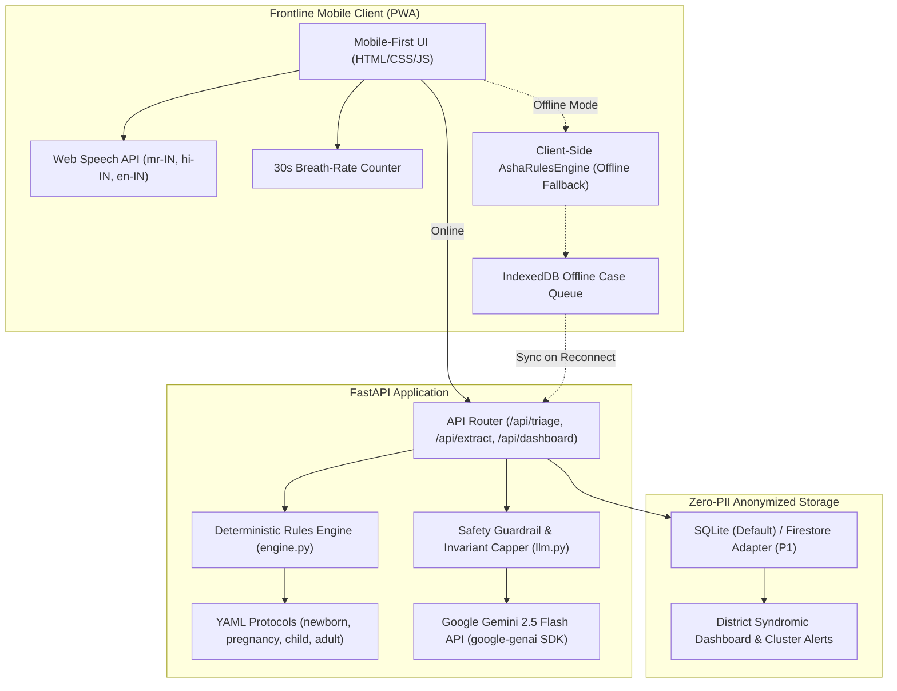
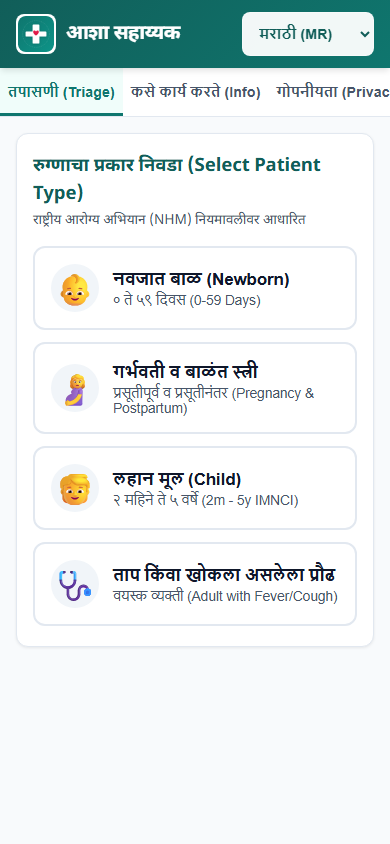
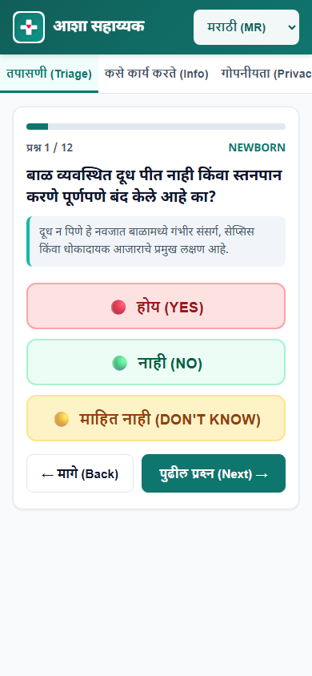
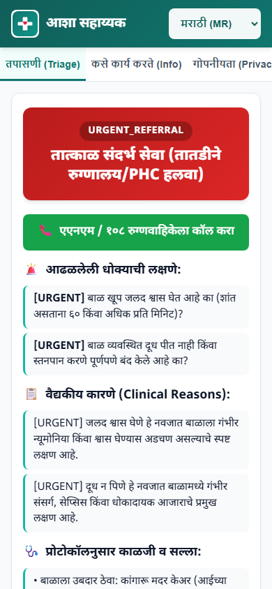
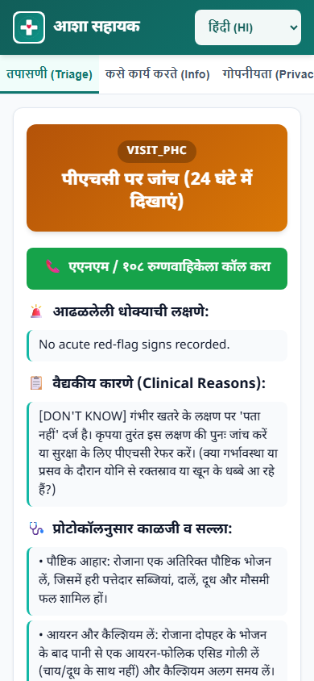
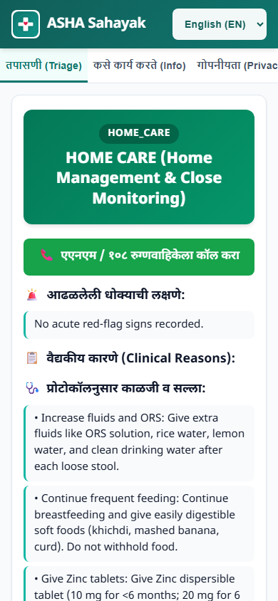
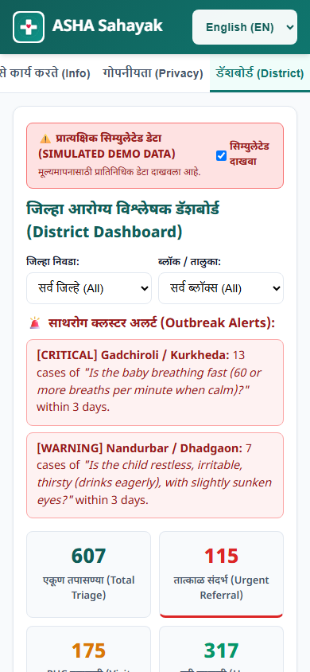

# ASHA Sahayak (आशा सहाय्यक)

[](tests/)
[-brightgreen)](docs/validation_report.md)
[-brightgreen)](docs/validation_report.md)
[](LICENSE)

> **Frontline Clinical Decision Support for Village Health Workers (ASHAs) in Rural Maharashtra.**  
> Built for the **Seva First Innovation Challenge** (*Theme: Healthy and Inclusive Bharat*).

---

## 1. What is ASHA Sahayak?

**ASHA Sahayak** is a mobile-first, offline-capable progressive web application (PWA) designed specifically for Accredited Social Health Activists (ASHAs) in rural and tribal districts of Maharashtra (e.g., Gadchiroli, Nandurbar, Nashik). 

Frontline ASHAs undergo 3 to 4 weeks of modular training and care for hundreds of families on basic Android smartphones under harsh field conditions with weak cellular connectivity. ASHA Sahayak empowers their clinical judgment with:
1. **Deterministic Danger-Sign Triage**: Structured symptom assessment across 4 key life stages:
   - **नवजात बाळ (Newborn 0 to 59 days)**
   - **गर्भवती व बाळंत स्त्री (Pregnancy and Postpartum)**
   - **लहान मूल (Child 2 months to 5 years / IMNCI)**
   - **ताप किंवा खोकला असलेला प्रौढ (Adult with Fever or Cough)**
2. **Three Clear Action Levels**:
   - 🔴 **`URGENT_REFERRAL`**: Immediate emergency facility transport (108 / 102 ambulance).
   - 🟡 **`VISIT_PHC`**: Clinical evaluation by PHC Medical Officer within 24 hours.
   - 🟢 **`HOME_CARE`**: Protocol home care (warmth, feeding, ORS) and warning signs to watch.
3. **Frontline Tools**:
   - **Voice Input (STT)**: Speaks symptoms in Marathi (`mr-IN`), Hindi (`hi-IN`), or English (`en-IN`).
   - **Breath-Rate Counter**: 30-second digital tap timer calculating breaths/minute and evaluating age-band pneumonia cutoffs.
   - **1-Click Referral Handover**: Formatted referral slip ready to Copy, Share to WhatsApp, Print/PDF, or Read Aloud via speech synthesis.
   - **Zero-PII Privacy**: No patient names, phone numbers, or GPS stored.
   - **District Outbreak Early-Warning**: Flags administrative blocks when $\ge 5$ cases with matching danger signs occur within 3 days.

---

## 2. System Architecture



---

## 3. Core Safety Invariants (Non-Negotiable)

1. **Rules Decide, Never the LLM**: All triage levels and danger-sign evaluations are computed by deterministic code anchored in national clinical protocols (NHM Modules 6 & 7, HBNC, and IMNCI).
2. **Escalation Cap & Monotonic Safety Invariant**:
   $$\text{final\_level} = \max(\text{rules\_level}, \min(\text{llm\_suggested\_level}, \text{VISIT\_PHC}))$$
   - The LLM can **never** lower a triage level under any circumstances.
   - The LLM may at most elevate `HOME_CARE` to `VISIT_PHC` if free-text describes an unlisted concern.
   - The LLM can **never** set `URGENT_REFERRAL` on its own.
   - *Verified via mathematical property testing across the full Cartesian product.*
3. **Urgent Danger Dominance**: Answering "YES" to any `URGENT` sign results in `URGENT_REFERRAL` regardless of other answers.
4. **"Don't Know" Uncertainty Escalation**: Answering "Don't Know" to an urgent question escalates triage to at least `VISIT_PHC` and instructs the worker to re-examine the sign.
5. **No Medical Diagnoses or Drug Dosing**: Triage outputs avoid disease labels as conclusions and never prescribe medications or milligram dosages. Advice is limited to protocol home care.
6. **Graceful Fallback**: If the Gemini API key is missing, network drops, or latency occurs, the app operates 100% on deterministic rule texts and templates with a standard guidance notice.
7. **Prompt Injection Resistance**: User input is wrapped in isolated data blocks, parsed against a strict JSON schema, and restricted to whitelisted sign IDs.

---

## 4. Mobile Screenshots (390 x 844 px)

| Language Selection | Patient Type | Danger Sign Question | Urgent Referral Result |
|---|---|---|---|
|  |  |  |  |

| Visit PHC Result | Home Care Result | PHC Referral Slip | District Dashboard & Alerts |
|---|---|---|---|
|  |  |  |  |

---

## 5. Environment Variables

| Variable | Required | Default | Description |
|---|---|---|---|
| `GEMINI_API_KEY` | Optional | *Unset* | Google Gemini API key. If unset, runs in deterministic rules-only fallback mode. |
| `GEMINI_MODEL` | Optional | `gemini-2.5-flash` | Gemini model name. |
| `PORT` | Optional | `8000` | Port for the HTTP server. |
| `HOST` | Optional | `0.0.0.0` | Server host binding. |
| `ANM_PHONE_NUMBER` | Optional | `+919876543210` | Telephone number linked to "Call ANM / 108" button. |
| `STORAGE_BACKEND` | Optional | `sqlite` | Storage engine (`sqlite` or `firestore`). |
| `SQLITE_DB_PATH` | Optional | `asha_sahayak.sqlite` | SQLite database file path. |
| `CLUSTER_ALERT_THRESHOLD_COUNT` | Optional | `5` | Case threshold triggering a block-level outbreak alert. |
| `CLUSTER_ALERT_DAYS` | Optional | `3` | Rolling time window (days) for syndromic cluster alerts. |

---

## 6. Local Setup and Execution

### 1. Clone & Set Up Environment
```bash
git clone https://github.com/shreyashdixit/asha-sahayak.git
cd asha-sahayak

# Create virtual environment
python -m venv .venv
source .venv/bin/activate  # On Windows: .\.venv\Scripts\activate

# Install dependencies & Playwright Chromium
pip install -r requirements.txt
python -m playwright install chromium
```

### 2. Configure Environment
```bash
cp .env.example .env
# Add your GEMINI_API_KEY (optional: app runs fully with fallback if omitted)
```

### 3. Seed Simulated District Data (~600 Cases)
```bash
python scripts/seed_simulated_data.py
```

### 4. Run Server
```bash
uvicorn app.main:app --host 0.0.0.0 --port 8000
# Open http://localhost:8000 in your browser or mobile emulator (390x844)
```

---

## 7. Verification and Testing

```bash
# 1. Run full unit and integration test suite (38 tests)
pytest tests -v

# 2. Run Python <-> JavaScript rules engine parity test (50 vignettes)
pytest tests/test_engine_parity.py -v

# 3. Run clinical vignette validation runner (50 cases)
python tests/run_vignettes.py

# 4. Run browser E2E Playwright smoke tests (covers all 4 modules, 3 languages, captures screenshots)
python scripts/e2e_smoke.py
```

---

## 8. Clinical Sources & Evidence Base

All danger signs, respiratory rate cutoffs, and temperature thresholds were extracted and verified against official Ministry of Health and Family Welfare (MoHFW) documents:
- **NHM ASHA Training Module 6**: Maternal & Newborn Care ("Simple Skills that Save Lives").
- **NHM ASHA Training Module 7**: Child Health, Nutrition & Childhood Illnesses.
- **Home Based Newborn Care (HBNC)**: Operational Guidelines & Danger Signs Checklist.
- **Integrated Management of Neonatal & Childhood Illness (IMNCI / F-IMNCI)**: Chart Booklet for Young Infants and Children 2m–5y.
- **National Tuberculosis Elimination Programme (NTEP)**: Presumptive TB Screening Protocols.
- **National Vector Borne Disease Control Programme (NVBDCP)**: Malaria & Dengue Community Screening.

See [docs/SOURCES.md](docs/SOURCES.md) for full citations and section mappings.  
See [docs/validation_report.md](docs/validation_report.md) for the 100% agreement self-consistency validation report.

---

## 9. Deployment

### Docker Deployment
```bash
docker build -t asha-sahayak .
docker run -p 8000:8000 -e GEMINI_API_KEY="your-key" asha-sahayak
```

### Cloud Deployment (Render / Cloud Run)
A production `render.yaml` configuration is included for zero-downtime deployment. Deploy directly by connecting your repository to Render or Google Cloud Run.
